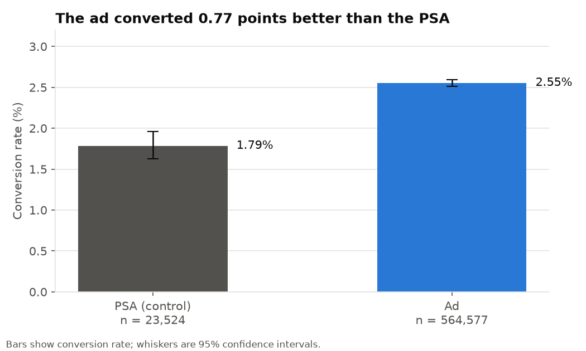
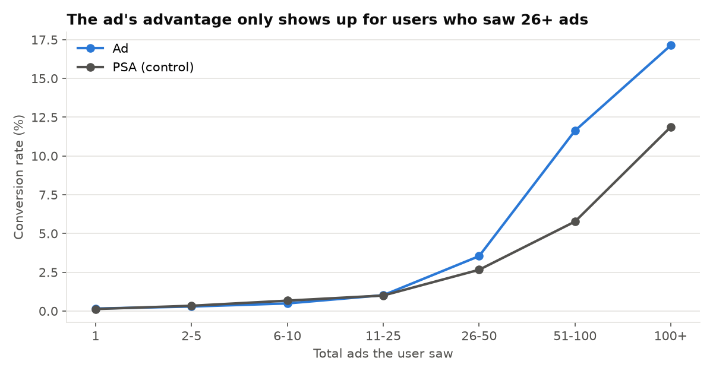

# Marketing A/B Test: Did the Ad Beat the PSA?

**Business question:** A company showed an advertisement to most users and a public service announcement (PSA, the control) to a small group. Did the ad increase conversions, by how much, and what should the company do next?

**Tools:** Python (pandas, SciPy, statsmodels, matplotlib). Methods: two-proportion z-test, chi-square, confidence intervals, bootstrap, logistic regression, power analysis, multiple-comparison correction.

## Answer in one paragraph

**Yes, the ad worked.** Conversion was **2.55% with the ad vs 1.79% with the PSA**, a lift of **0.77 percentage points (95% CI 0.59 to 0.94), or about 43% relative (95% CI 30% to 58%)**; p < 0.0001. The result holds after adjusting for day and hour imbalances. But the lift is not spread evenly: users who saw **25 ads or fewer showed no difference (0.60% vs 0.61%)**, and the whole effect sits with users who saw more than 25 ads. The company should keep the ad, but the next test should be designed to find out whether more exposure *causes* the lift.

## Key results

| | Ad | PSA (control) |
|---|---|---|
| Users | 564,577 | 23,524 |
| Conversions | 14,423 | 420 |
| Conversion rate | 2.555% (95% CI 2.514 to 2.596) | 1.785% (95% CI 1.624 to 1.963) |

- **Difference:** +0.769 percentage points; 95% CI 0.595 to 0.943 (a bootstrap CI gives 0.593 to 0.940).
- **Tests:** two-proportion z = 7.37, p = 1.7e-13; chi-square gives the same p-value.
- **Adjusted for peak day and hour** (logistic regression): odds ratio 1.44 (95% CI 1.31 to 1.59), average effect 0.77 points, identical to the unadjusted result.
- **Power:** the control group (23.5k users) could reliably detect a conversion rate of about 2.04% or higher (a 14% relative lift) at 80% power, so the observed 43% lift is far above what the test could detect. A 50/50 test would have needed about 5,600 users per group to detect this lift.

## Where the lift comes from

| Total ads seen | Ad | PSA | Lift (points) |
|---|---|---|---|
| 25 or fewer (n = 412,634 ad / 17,388 PSA) | 0.60% | 0.61% | -0.01 (p = 0.86) |
| More than 25 (n = 151,943 / 6,136) | 7.87% | 5.12% | +2.75 (p < 0.0001) |

Users who saw more than 25 ads were 27% of the ad group but produced **83% of its conversions**. Conversion rises with the number of ads seen in both groups, and the ad pulls ahead of the PSA from about 26 ads on (51-100 ads: 11.6% vs 5.8%).

**Read this carefully:** the number of ads a user saw is recorded *after* the user was assigned to a group, and people who browse more naturally see more ads and are more likely to buy. So this split is descriptive. It shows where the lift appears, not that showing more ads causes more conversions.

## Checks on the experiment

- **Data:** 588,101 users, no missing values, no duplicate users.
- **Group sizes:** 96% ad, 4% PSA. The planned split is not documented in the dataset, so a sample-ratio-mismatch test could not be run. The very unbalanced split is unusual and is worth confirming with whoever ran the test.
- **Randomization:** total ads seen is similar (mean 24.8 in both groups). Peak day and peak hour differ statistically between groups (p < 1e-28), but the differences are tiny in size (Cramer's V about 0.02) and adjusting for them does not change the result. With 588k users, even small gaps become "significant", so the effect size is what matters.
- **Subgroups (exploratory):** I tested the lift by peak day and peak hour (27 comparisons; hours with fewer than 100 control users skipped). 13 were significant at p < 0.05, but only 4 (Monday, Tuesday, Wednesday and 2 pm) survive a Bonferroni correction. The control group is small in each subgroup, so I do not draw conclusions from these.

## Recommendations

1. **Keep running the ad.** The lift is large, statistically solid, and robust to the checks above.
2. **Run a follow-up test on exposure.** Randomly assign users to different ad frequencies (for example a cap at 10, 25 and 50). That answers whether pushing more impressions causes the extra conversions, or whether heavy users would have converted anyway.
3. **Fix the design of the next test.** Use a documented split that is closer to balanced (for example 80/20 or 50/50), and record the planned split so a sample-ratio check can be run. This shrinks the confidence interval on the control group, which is the wider one here.
4. **Add business data before judging ROI.** The dataset has no revenue or cost, so I cannot say whether a 0.77 point lift pays for the ad spend. Compare the extra conversions with the cost of the extra impressions.

## Limitations

- No revenue, cost or customer data, so no return-on-investment calculation.
- The control group is small (4%), so subgroup results for the PSA group are noisy.
- Total ads seen is measured after assignment, so the exposure analysis is not causal.
- Whether the PSA is a "do nothing" control or a real alternative message affects how to read the lift; the dataset does not say.

## How to reproduce

1. Download the "Marketing A/B Testing" dataset from Kaggle (search for it by name) and put `marketing_AB.csv` in `data/`.
2. `pip install -r ../requirements.txt`
3. `python analysis.py` prints every number above and saves the charts and tables to `outputs/`. The full printed output is saved in `outputs/analysis_output.txt`.

## Data source and license

*Marketing A/B Testing* (Kaggle), released under **CC0 (public domain)**. The raw file is not committed to this repository.
