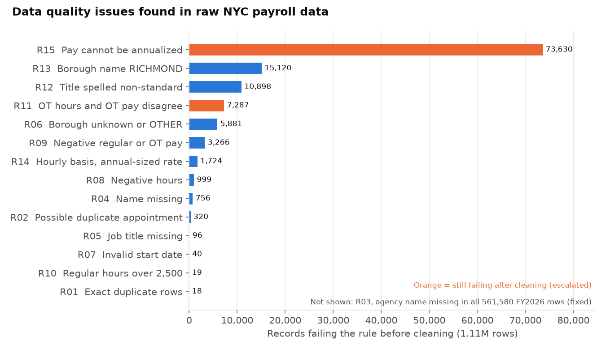
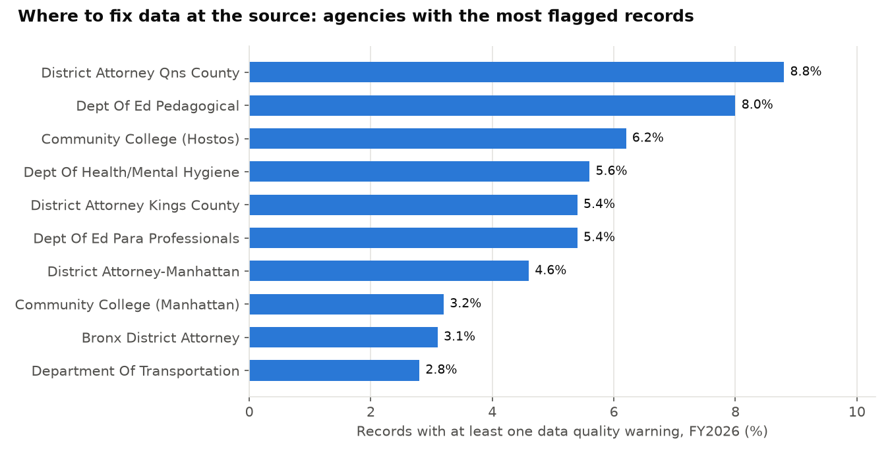
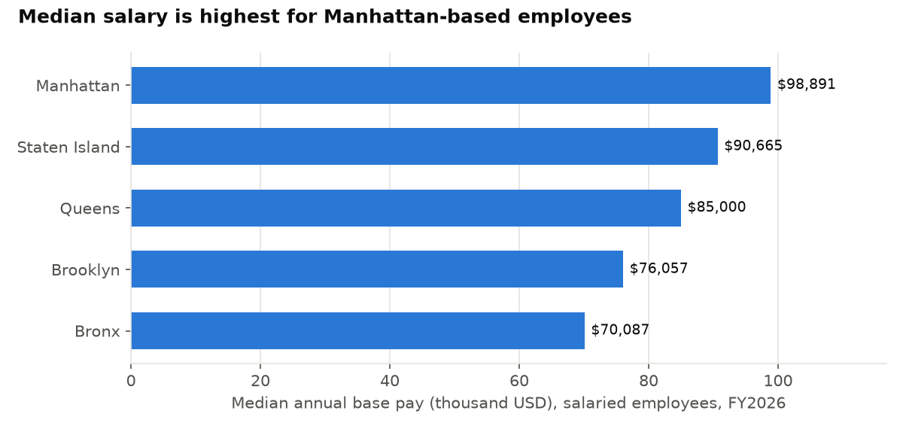

# NYC Payroll Data Quality and Governance Case Study

## Question
Can two years of NYC employee payroll data (1.1 million records) be trusted for reporting, and what has to be fixed, documented and escalated before it can be?

This project treats the data like a team inheriting a messy source: profile it, write requirements, clean and standardize it, validate it against those requirements, document it, and recommend how to stop the same problems recurring.

## Data
- **Source:** NYC Open Data, Citywide Payroll Data (Fiscal Year), published by the NYC Office of Payroll Administration. https://data.cityofnewyork.us/ (dataset id `k397-673e`).
- **Used:** FY2025 (550,219 rows) and FY2026 (561,580 rows), downloaded through the public API on 2026-11-04.
- **Privacy:** the raw files contain employee names (public records). They are **not** in this repo. The curated table drops names and uses a hashed key.
- Check the NYC Open Data terms of use for reuse conditions.

## Scenario note
The stakeholders, requirements and thresholds in `docs/01_requirements.md` are **simulated** for this case study. No real interviews or employer work are involved.

## What is in the repo

| Area | Files |
|---|---|
| Requirements | [docs/01_requirements.md](docs/01_requirements.md): stakeholders, requirements REQ-01 to REQ-07 with testable acceptance criteria, open questions |
| Data dictionary and metrics | [docs/02_data_dictionary.md](docs/02_data_dictionary.md) |
| Lineage | [docs/03_lineage.md](docs/03_lineage.md): flow diagram, layers, transformations, reconciliation |
| Assumptions and limits | [docs/04_assumptions_limitations.md](docs/04_assumptions_limitations.md) |
| Process improvement | [docs/05_process_improvement.md](docs/05_process_improvement.md): defect, likely cause, control |
| SOP | [docs/06_sop_quality_run.md](docs/06_sop_quality_run.md): how to run the recurring check |
| SQL (PostgreSQL) | `sql/01_profile.sql`, `02_clean.sql`, `03_validation.sql`, `04_analysis.sql` |
| Python | `load_raw.py`, `run_pipeline.py` (one-command automation), `stats_analysis.py`, `build_scorecard.py`, `make_charts.py` |
| Report | `outputs/dq_scorecard.xlsx`: Excel scorecard with live pass/fail formulas |

## Method
1. **Load raw as text** so no defect is hidden by type conversion.
2. **Profile** completeness, validity, uniqueness and consistency (`01_profile.sql`).
3. **Clean without guessing** (`02_clean.sql`): standardize text, convert types, rebuild missing reference data, flag every defect. Only exact duplicates are removed. Records that would make pay totals unreliable are quarantined with `is_report_ready = FALSE`, not deleted.
4. **Validate** 15 rules tied to the requirements, plus reconciliation of row counts and total pay (`03_validation.sql`).
5. **Analyse** the cleaned data with CTEs, window functions (`NTILE`, `RANK`, `PERCENTILE_CONT`) and statistics in Python.

## Key findings
All numbers were produced by running the code in this repo.

**Data quality**
1. **FY2026 has no agency name at all.** All 561,580 FY2026 rows are missing it, while FY2025 is 100% complete. The code `payroll_number` maps to exactly one agency, so the names were rebuilt from FY2025, and all 158 codes matched.
2. **Pay units are mixed and sometimes wrong.** `base_salary` can be per year, day or hour. 71,716 hourly rows have a rate of $2 or less (97.5% are election workers, so this looks like a placeholder for flat-fee work). 1,724 hourly rows have annual-sized rates, all custodian engineers. These were not guessed: annualized pay is left blank for them.
3. **Inconsistent text.** 10,898 job titles differ only by capitalization, and 15,120 rows use the borough name RICHMOND (Staten Island).
4. **Invalid values.** 999 rows have negative hours, 3,266 have negative regular or overtime pay, and 40 start dates are 9999-12-31 or in the future. 18 rows are exact duplicates and 320 more are possible duplicates, flagged for review.
5. **Result.** 13 of 15 rules pass after cleaning. 5,199 records (0.47%) are quarantined from pay totals. Two rules still fail and are escalated: overtime hours and overtime pay disagree in 7,287 rows (0.66%, target 0.1%), and 73,630 rows (6.6%, target 5%) cannot be annualized.
6. **Reconciliation.** Raw rows minus duplicates equal curated rows in both years, and total pay is identical before and after cleaning ($71,060,075,603.52). The curated table has no name columns.
7. **Cross-year consistency.** Of 451,634 people found in both years, 2,084 (0.46%) have a different agency start date in FY2026.

**What the cleaned data shows** (report-ready rows)
- Gross pay rose from $34.46B (FY2025) to $36.33B (FY2026), up 5.4%. Overtime was 8.5% of gross pay in FY2025 and 8.3% in FY2026.
- The top 5% of overtime earners received 22.0% of the $3.02B FY2026 overtime pay.
- Median salary for salaried staff is highest for Manhattan-based employees ($98,891) and lowest for the Bronx ($70,087).
- Pay rises with tenure: Spearman correlation 0.46, and each extra year of tenure is associated with about 1.8% higher base pay (regression with borough controls, R-squared 0.17). Borough differences are descriptive only because job and agency are not controlled for.
- Lowest same-agency retention among large agencies: election poll workers (67.4%), per-diem teachers (72.7%).





## Limitations
No employee ID exists, so people are matched on name, agency and start date and employee counts are estimates. Only two years are used, so no forecasting is attempted. Thresholds and assumptions are judgment calls listed in [docs/04_assumptions_limitations.md](docs/04_assumptions_limitations.md).

## How to reproduce
1. Install PostgreSQL. The scripts create the database `nyc_payroll`.
2. Download the two fiscal-year CSVs into `data/` as `payroll_fy2025.csv` and `payroll_fy2026.csv`:
   `https://data.cityofnewyork.us/resource/k397-673e.csv?fiscal_year=2025&$limit=700000` (and `2026`).
3. Provide the database password through `pgpass.conf` or the `PGPASSWORD` variable. Do not put it in any file in the repo.
4. Run:
```
pip install -r ../requirements.txt
python run_pipeline.py --load
```
The full run takes about two minutes. Results are written to `outputs/`.
