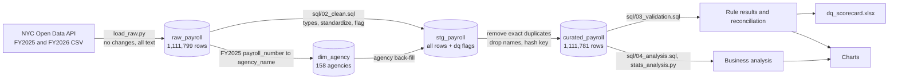

# Data Lineage

## Flow

## Layers

| Layer | Object | Rows | Purpose | Owner of change |
|---|---|---|---|---|
| Source | NYC Open Data API, dataset k397-673e | 550,219 (FY2025), 561,580 (FY2026) | Publisher's data, not modified | Publisher |
| Raw | raw_payroll | 1,111,799 | Exact copy as text, so every defect is preserved and measurable | load_raw.py |
| Reference | dim_agency | 158 | payroll_number to agency name, built from FY2025 | 02_clean.sql |
| Staging | stg_payroll | 1,111,799 | Typed and standardized, every rule shown as a flag | 02_clean.sql |
| Curated | curated_payroll | 1,111,781 | Privacy-safe, duplicates removed, report-ready flag | 02_clean.sql |
| Output | CSVs, charts, dq_scorecard.xlsx | n/a | Findings and quality scorecard | run_pipeline.py |

## Transformations by field

| Output field | From | Transformation |
|---|---|---|
| agency_name | payroll_number | Lookup in dim_agency (FY2026 source has none) |
| work_borough | work_location_borough | Upper case, RICHMOND to STATEN ISLAND, blanks to UNKNOWN, other counties to OUTSIDE NYC |
| title | title_description | Upper case, collapse spaces, NULL to UNKNOWN |
| start_date | agency_start_date | Cast to date, set NULL if before 1900 or after fiscal year end |
| annualized_base | base_salary, pay_basis | Convert to yearly using 260 days or 2,080 hours, NULL if flagged |
| employee_key | agency code, name, initial, start date | MD5 hash |
| gross_pay_total | three pay columns | Sum |

## Reconciliation checks
- Raw rows minus exact duplicates equals curated rows, for each year (sql/03_validation.sql, V2).
- Total pay is identical before and after cleaning: $71,060,075,603.52 (V3).
- Curated table has no name columns (V4).
