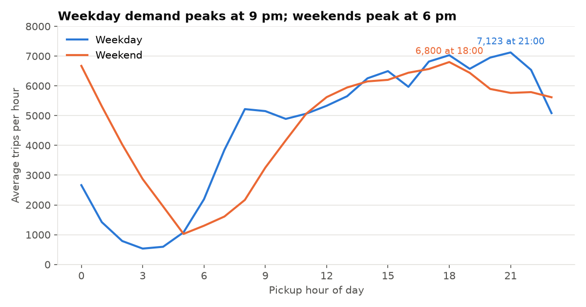
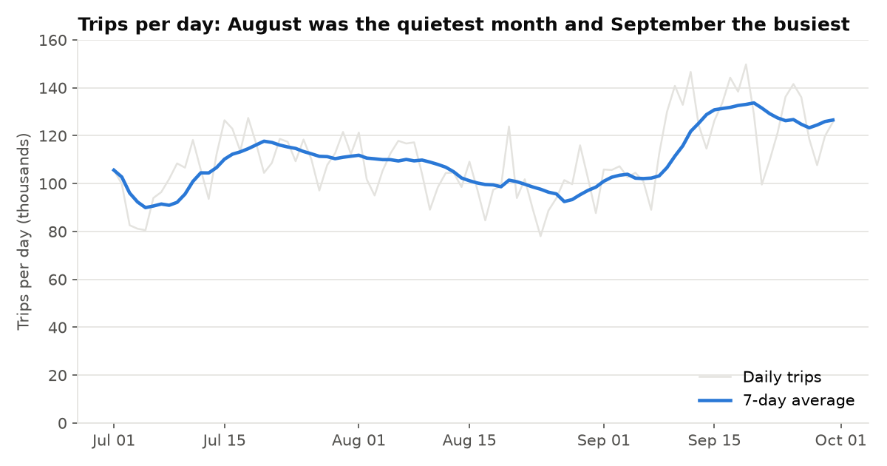
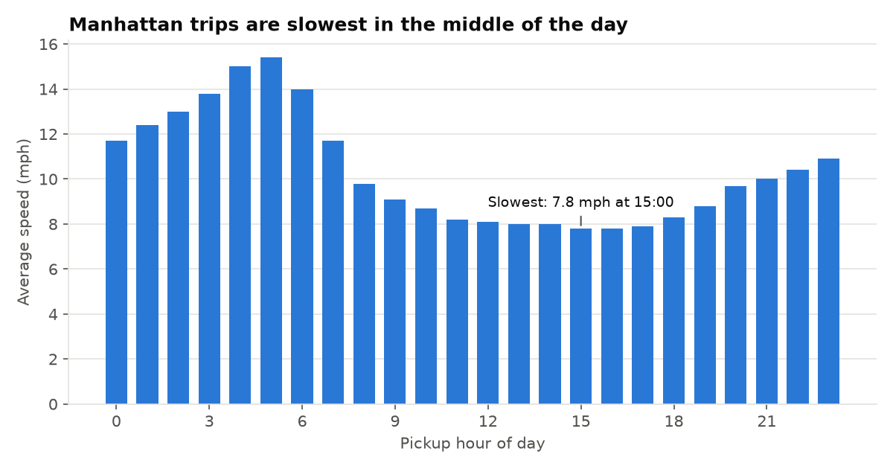

# NYC Yellow Taxi: Demand, Fares and Tips (PostgreSQL)

## Question
When and where do New York City yellow taxi trips happen, and what drives fares and tips? The analysis covers demand by hour and weekday, the busiest pickup zones, airport versus non-airport trips, and tipping behaviour.

## Data
- **Source:** NYC Taxi and Limousine Commission (TLC) Trip Record Data, yellow taxi trips for **July, August and September 2026** (Parquet files) and the Taxi Zone Lookup table. https://www.nyc.gov/site/tlc/about/tlc-trip-record-data.page
- **Size:** 10,742,869 raw trips, 10,140,570 after cleaning (94.39% kept).
- Public data published by the TLC. Check the TLC page for current terms of use. The raw files are not stored in this repo.
- Yellow taxis only: green taxis and app-based services (Uber, Lyft) are not included, so this is not the whole NYC ride market.

## Method
- **Database:** PostgreSQL 18, loaded from Parquet with `load_data.py` (psycopg `COPY`). The password is read from `pgpass.conf` and is never in the code.
- **Cleaning:** a view, `trips_clean` (`sql/01_clean.sql`), joins trips to zone names and removes impossible rows. Each rule is counted in `sql/00_data_checks.sql`.

| Rule | Rows failing it |
|---|---|
| Pickup date outside Jul to Sep 2026 | 29 |
| Dropoff not after pickup | 133,703 |
| Duration under 1 minute or over 3 hours | 114,787 |
| Distance zero | 394,539 |
| Distance over 100 miles | 432 |
| Fare of zero or less | 50,702 |
| Total of zero or less | 46,303 |

A trip can fail several rules, so these counts add up to more than the 602,299 rows removed. The thresholds (1 minute, 3 hours, 100 miles, 80 mph) are judgment calls, not TLC rules. Changing them would move the totals slightly.

- **Analysis:** nine queries in `sql/02_analysis.sql` using CTEs, window functions (`SUM() OVER`, `AVG() OVER` with a rolling frame, `LAG`, `RANK() OVER PARTITION BY`) and conditional aggregation (`FILTER`).

## Key findings
All numbers come from the clean data and were produced by the SQL in this repo.

1. **Demand peaks late in the day.** On weekdays the busiest hour is 9 pm (about 7,100 trips per hour) and the quietest is 3 am (about 530). On weekends the daytime peak is 6 pm (about 6,800), but the midnight hour is nearly as busy (about 6,700), which is mostly Friday and Saturday nights.
2. **Manhattan is 87.4% of pickups**, with an average fare of $18.32 over 2.8 miles. Queens is 9.0% of pickups but its average fare is $50.49 over 11.5 miles, driven by airport trips.
3. **JFK Airport is the single busiest pickup zone** (433,422 trips, 4.3%). The top 10 zones account for 33.6% of all trips, and nine of them are in Manhattan.
4. **Airport trips pay more in total but less per mile.** 884,692 trips touch an airport (8.7%). Their average fare is $56.08 against $18.43 for other trips, but $4.31 per mile against $6.67. Card tips are 21.7% of the fare for airport trips versus 25.4% for others.
5. **Tipping.** 62.8% of trips are paid by credit card. Cash tips are not recorded, so tip analysis uses card trips only. Among them the average tip is highest at 6 pm (26.8% of the fare) and lowest at 4 am (20.9%), and 8.7% of card trips leave no tip.
6. **Manhattan traffic.** For trips that start and end in Manhattan, average speed is lowest for 3 pm pickups (7.8 mph) and highest for 5 am pickups (15.4 mph).
7. **Seasonality within the quarter.** Average trips per day were 107,519 in July, 101,668 in August and 121,859 in September. The busiest single day was 19 Sep (149,782 trips) and the quietest 24 Aug (78,008). These data cannot explain why; the cause would need other sources such as events, weather or holidays.

## Data quality notes and limits
- 27.5% of clean trips have `payment_type` 0 and no passenger count, with an average tip of $0.31. They are not credit card or cash trips, so they are excluded from the tip analysis. Check the TLC data dictionary for how that code is defined.
- Tip percentage is the tip divided by the metered fare (`fare_amount`), averaged per trip.
- A small number of trips have pickup borough "Unknown" or "N/A" (the TLC placeholder zones). They are kept in the borough table for completeness.
- Three months of data show a pattern for a season, not a year.

## Charts




## How to reproduce
1. Install PostgreSQL and create a database: `CREATE DATABASE nyc_taxi;`
2. Download the three monthly Parquet files and `taxi_zone_lookup.csv` from the TLC page into `data/`.
3. Install dependencies and set the password through `pgpass.conf` or the `PGPASSWORD` variable (never commit it):
```
pip install -r ../requirements.txt
python load_data.py
python run_sql.py sql/01_clean.sql
python run_sql.py sql/00_data_checks.sql
python run_sql.py sql/02_analysis.sql
python make_charts.py
```
Query results are saved as CSVs in `outputs/`. Set `NYC_TAXI_DSN` to change the connection string.
