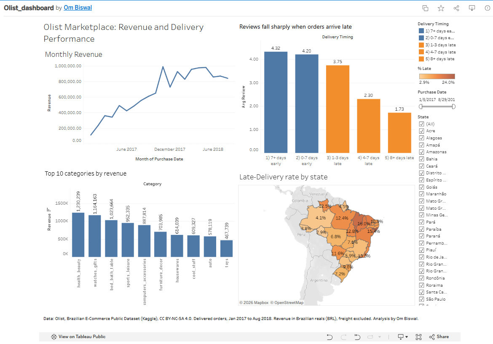
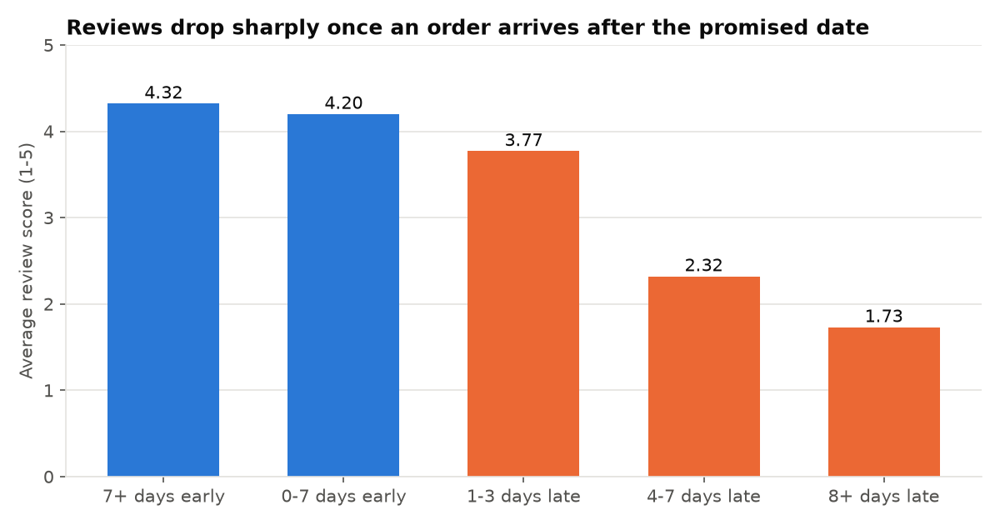
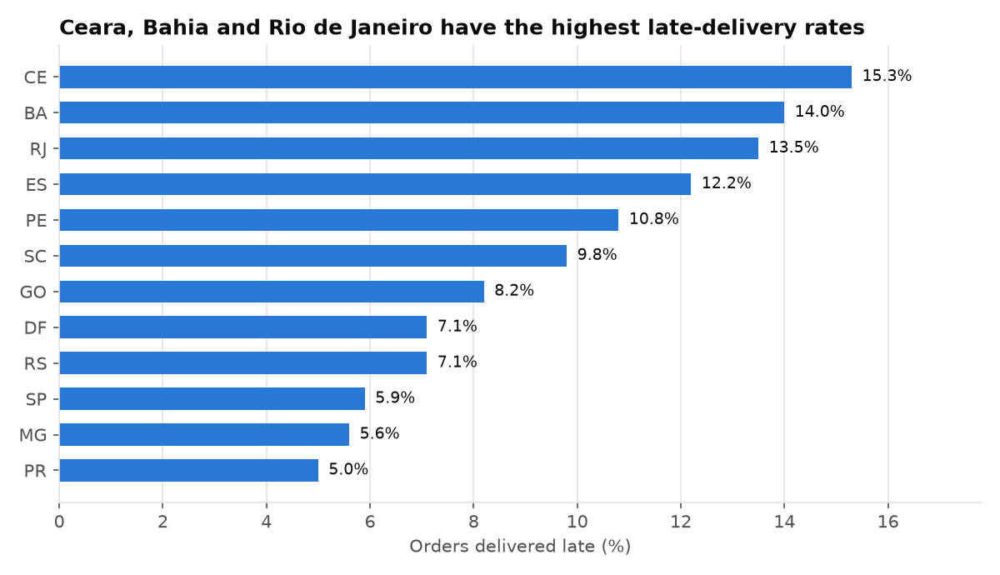
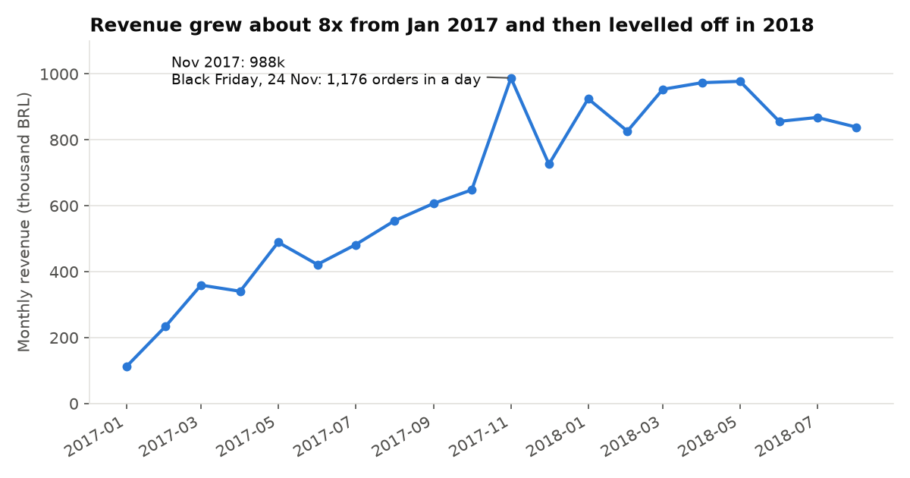

# Olist E-commerce: Delivery Experience and Revenue Growth (SQL)

**Business question:** For a Brazilian online marketplace, how do late deliveries affect customer satisfaction, where do they happen, and how is revenue growing and where does it come from?

**Tools:** SQL (SQLite: CTEs, window functions, multi-table joins), Python (pandas, matplotlib) for loading data and charts.

## Key findings

All figures are delivered orders from Jan 2017 to Aug 2018 unless noted. Currency is Brazilian reals (BRL).

**Delivery and customer experience**
1. **Late delivery is rare but costly.** 8.1% of 96,470 delivered orders arrived after the promised date. Those orders average **2.57 stars vs 4.29** for on-time orders, and 54.1% of them got a 1 or 2 star review (9.2% for on-time).
2. **The damage grows with delay.** Orders 1-3 days late average 3.77 stars, 4-7 days late 2.32, and 8+ days late **1.73 stars (78.4% leave 1-2 stars)**. Orders that arrive early score 4.2-4.3.
3. **Geography matters more than product type.** Late rates are 15.3% in Ceara, 14.0% in Bahia and 13.5% in Rio de Janeiro, against 5.9% in Sao Paulo and 5.0% in Parana. Across product categories the late rate only ranges from 8.5% to 9.8% among the ten worst, so category is not the main driver.
4. **Cross-state shipping is slower.** Single-seller orders shipped to a different state are late 9.4% of the time (15.2 days on average) vs 6.1% (8.0 days) when seller and customer share a state.
5. Olist's delivery promises are cautious: orders take 12.6 days on average against 23.7 days promised.

**Revenue and growth**
1. **Revenue grew about 8x** from 112k BRL in Jan 2017 to a peak of 988k in Nov 2017, then levelled off at 830k-980k a month through Aug 2018.
2. **Year over year (Jan-Aug):** orders rose from 21,998 to 52,783 and revenue from 2.99M to 7.22M BRL (+141%), while average order value stayed flat (136.08 vs 136.75 BRL). Growth came from more orders, not bigger baskets.
3. **Black Friday:** 24 Nov 2017 had 1,176 orders in one day, against an October 2017 daily average of about 149.
4. **Revenue is concentrated.** The top 20% of sellers (594 of 2,970) bring in **82.3%** of revenue. The top 10 categories make 62.4%, led by health_beauty (9.3%), watches_gifts (8.8%) and bed_bath_table (7.7%).
5. **Sao Paulo state is 38.3% of revenue,** followed by Rio de Janeiro (13.3%) and Minas Gerais (11.7%).
6. **Credit cards pay for 75.5% of orders.** Boleto (a Brazilian bank slip) is 19.9% and has a lower average order value (121.40 vs 143.24 BRL).
7. **Shipping eats small orders:** freight is 48.4% of item value on orders under 50 BRL, and 9.0% on orders of 200+ BRL.

## Recommendations

- **Fix the late-delivery hotspots first.** Target Ceara, Bahia and Rio de Janeiro with carrier or fulfilment changes, or with longer promised dates there. The review penalty for 4+ days late is large.
- **Promise more accurately.** Since most orders arrive about 11 days earlier than promised, tighter estimates in fast regions would help conversion, while honest, longer estimates in slow regions would cut the late rate.
- **Watch the long tail of slow sellers** (some with 50+ orders are late 20-30% of the time) before they damage ratings.
- **Growth has stalled since spring 2018.** With flat average order value, the levers are new customers, repeat purchases and cutting freight cost on small orders.
- **Seller concentration is a risk.** Losing a handful of top sellers would hit revenue hard.

## Caveats

- This is observational data. Late orders and low reviews go together, but late orders may also differ in other ways (distance, product, seller), so the numbers show association, not proof of cause.
- Only 2017-01 to 2018-08 has full months; 2016 and Sep-Oct 2018 have only a few hundred orders or fewer, so they are excluded from the trend.
- Revenue = sum of item prices on delivered orders (freight excluded). Canceled, unavailable and in-progress orders are excluded.
- 551 orders have more than one review; the most recent review is used. 775 orders have no items and are excluded from revenue. 249 orders have payments that differ from item totals by more than 1 BRL; this analysis does not use payment totals for revenue.
- Seller-level late rates use 50+ orders per seller, so single sellers still carry some noise.

## Interactive dashboard

**[Open the Tableau Public dashboard](https://public.tableau.com/app/profile/om.biswal/viz/Olist_dashboard_17937939194590/OlistDashboard)**: monthly revenue, top 10 categories, review score by delivery timing and late-delivery rate by state, with date and state filters. Click a state or category to filter every chart. Built from `tableau/olist_orders_for_tableau.csv`; the step-by-step build is in `tableau/BUILD_GUIDE.md`.

## Charts

## How to reproduce

1. Download the dataset from Kaggle: [Brazilian E-Commerce Public Dataset by Olist](https://www.kaggle.com/datasets/olistbr/brazilian-ecommerce) and put the 9 CSV files in `data/`.
2. `pip install -r ../requirements.txt`
3. `python build_db.py` creates `olist.db` (SQLite).
4. `python run_sql.py sql/00_data_checks.sql` (and `01_delivery_experience.sql`, `02_revenue_growth.sql`). Results print and are saved as CSVs in `outputs/`.
5. `python make_charts.py` rebuilds the charts.

## Project files

| File | What it does |
|---|---|
| `sql/00_data_checks.sql` | Data quality checks (duplicates, missing dates, date range, reconciliation) |
| `sql/01_delivery_experience.sql` | Set 1: 7 queries on delivery and reviews |
| `sql/02_revenue_growth.sql` | Set 2: 7 queries on revenue, categories, sellers, payments |
| `build_db.py`, `run_sql.py`, `make_charts.py` | Loading, query runner, charts |

## Data source and license

Olist, *Brazilian E-Commerce Public Dataset by Olist* (Kaggle), licensed **CC BY-NC-SA 4.0** (attribution, non-commercial, share-alike). The raw data files are not included in this repository; download them from Kaggle. This analysis is for portfolio and educational use.
